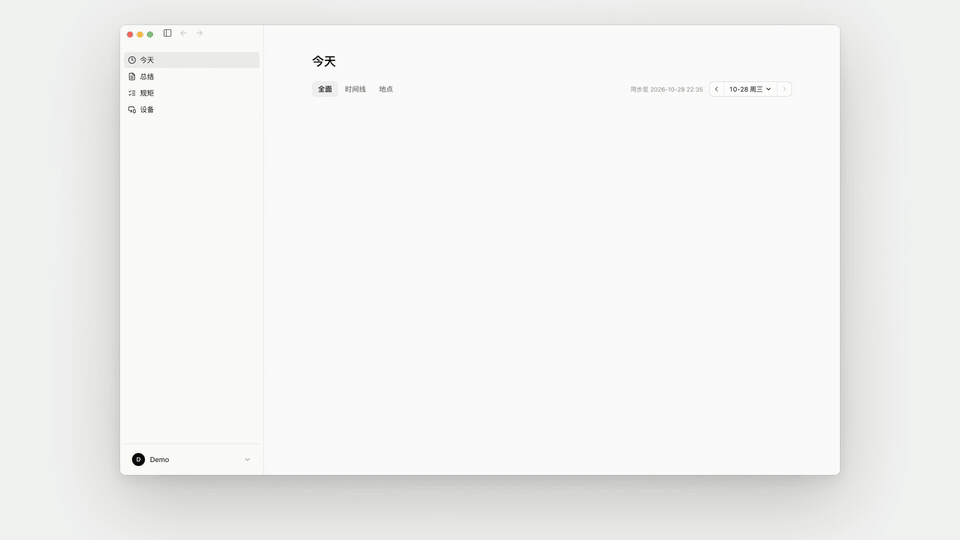
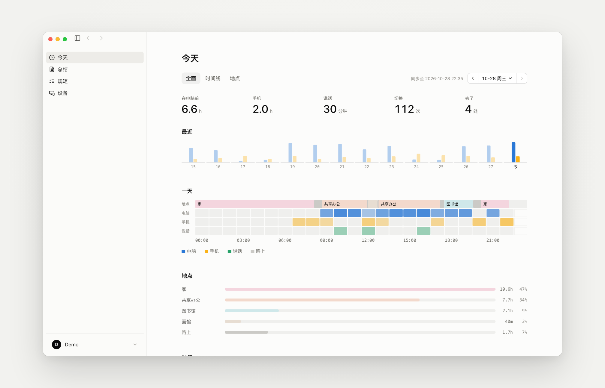
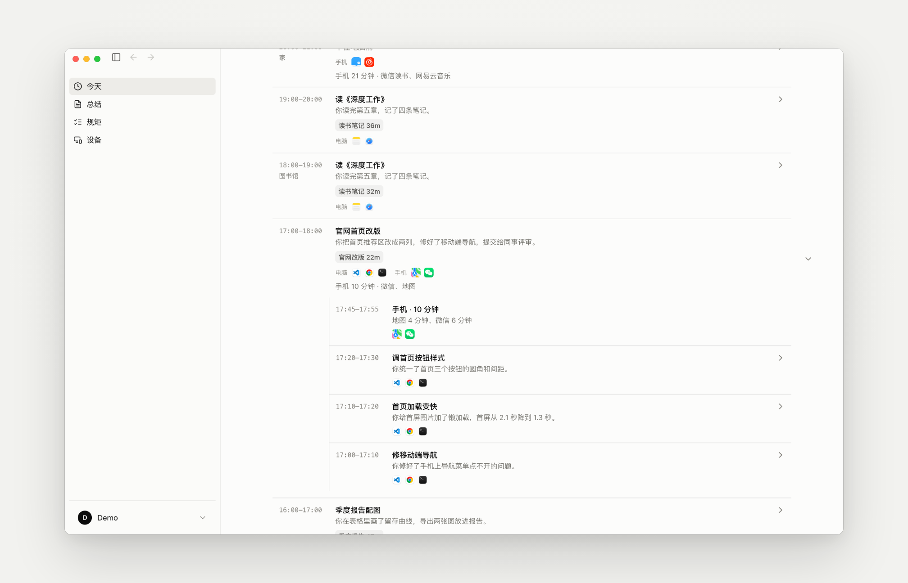
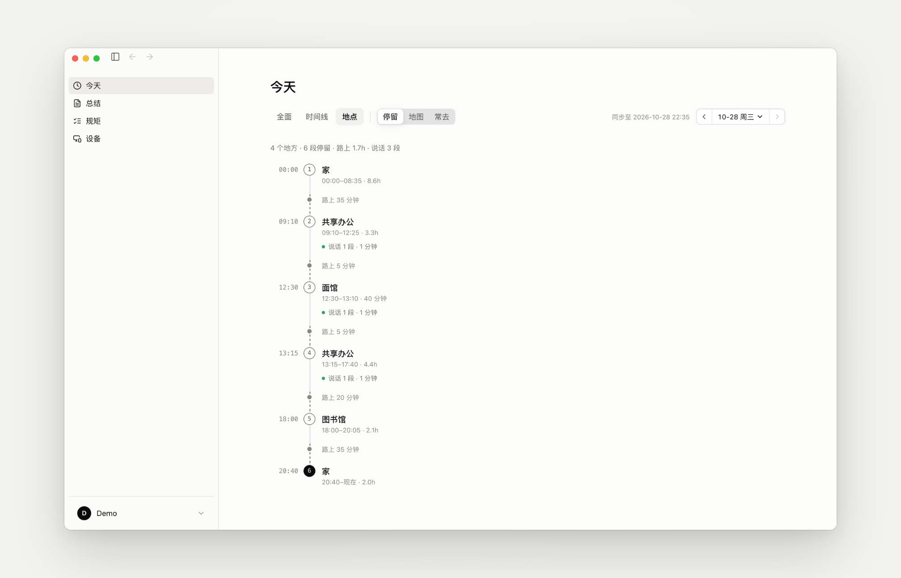
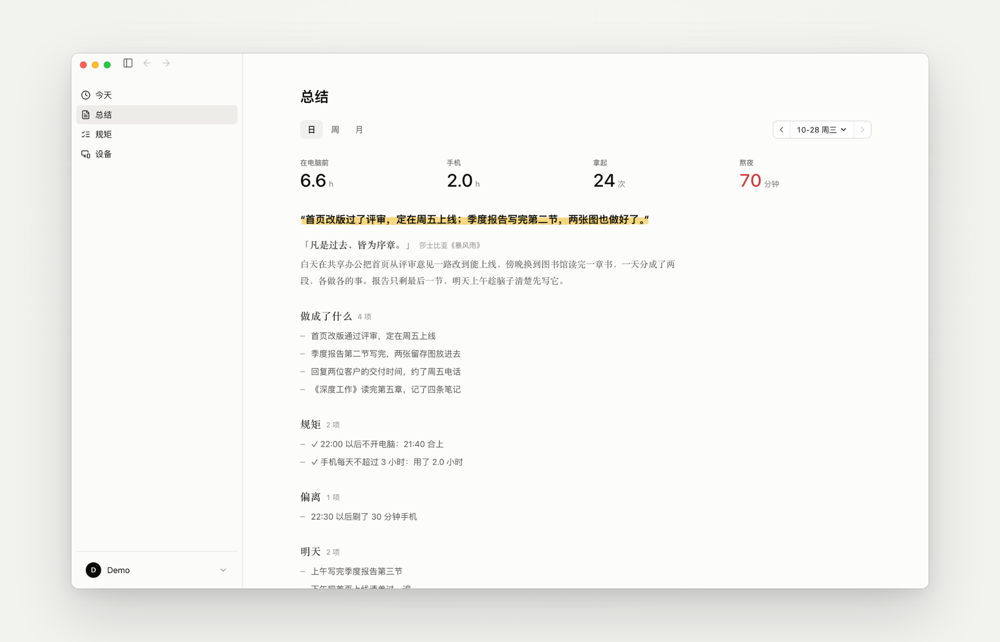
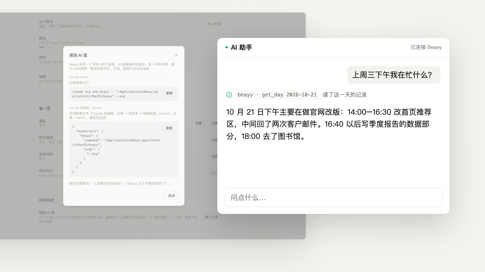
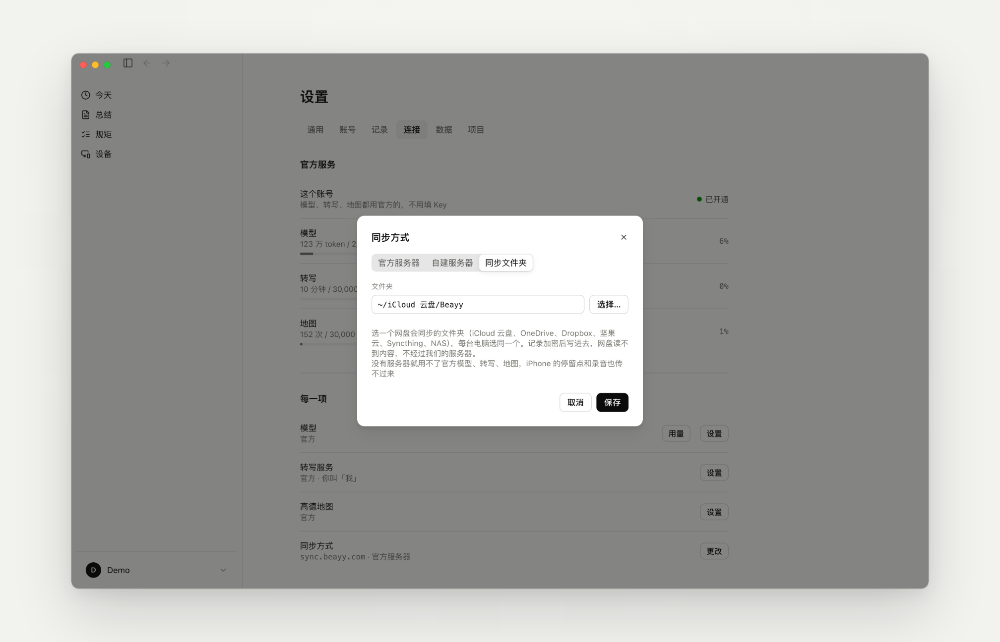

<div align="center">


# Beayy

**Your day, written down automatically: when, where, and what you were doing**

Your computer, phone and watch together, plus the places you went.<br>
A summary every 10 minutes, a journal every evening, rolled up into weekly and monthly reviews.

*Be Authentic. Your Yesterdays.*

[简体中文](README.md) · **English**

[](https://github.com/hengfengliya/beayy/releases/latest)
[](LICENSE)


[Download for Mac / Windows](https://github.com/hengfengliya/beayy/releases/latest) · [iPhone & Apple Watch (TestFlight)](https://testflight.apple.com/join/Ptzqu4q8) · [beayy.com](https://beayy.com)



</div>

At the end of a busy day it's hard to remember what you actually did. Screen Time tells you that you spent three hours in Chrome, not what you were doing in it. Beayy runs in the background on your computer, phone and watch, and has a language model write the log for you. You just read it.

The interface comes in English and Simplified Chinese (Settings → General → Language; it follows your system by default). Summaries and journals are still written in Chinese for now. The screenshots below use made-up sample data.

## The shape of your day

How long you were at the computer, how long on your phone, how many times you switched apps, how many places you went. The day strip lays out places, sleep, computer, phone and conversations hour by hour, and your time is sorted by project and by type of work.

With the iPhone app you can also bring in Apple Health: when you fell asleep and woke up, how long you slept, how many steps you took and how long you worked out.

<p align="center"></p>

## Every 10 minutes

The timeline lists what you were doing each hour. Open an hour to see a summary for every 10 minutes, the apps you used, and what you did when you picked up your phone.

<p align="center"></p>

## Where you went

With the iPhone app, Beayy records the places you stayed, when you arrived and left, and guesses which shop or café it was. Name the places you go often. It keeps stops only, never the route in between.

<p align="center"></p>

## Daily, weekly and monthly reviews

Every evening Beayy writes a journal entry: one line about the day, a short remark that opens with a quote from a book or a well-known person, what got done, where you drifted, and what's next, plus where you went and where your time went. A weekly review follows each week and a monthly review each month. If your iPhone data arrives late, hit "regenerate".

Write rules in your own words, such as "no computer after 22:00" or "less than 3 hours of phone a day", and the journal checks the day against them.

<p align="center"></p>

## Ask your own past

Beayy ships a local MCP server. Connect it to Claude Code, Claude Desktop or Cursor and ask things like "what was I working on last Wednesday afternoon?" or "which night did I stay up latest this month?". It's read-only, and the data never leaves your computer.

```bash
claude mcp add beayy -- "/Applications/Beayy.app/Contents/MacOS/beayy" --mcp
```

The config snippet for Claude Desktop and Cursor is under Settings → Connections → Connect to AI. Tools: `list_days` (an overview of recent days), `get_day` (time spent, what you did each hour, where the time went, and the journal for a day), `search` (keyword search over the 10-minute summaries), `get_rules_and_projects`.

<p align="center"></p>

## Your data stays yours

Everything is stored on your computer. To sync between devices, pick one of three options:

- **Official server**: open sign-up, no invite code, 100 MB of sync space and 50,000 tokens of the official model per month per account, 50 accounts for now
- **Self-hosted**: the server lives in [`server/`](server/README.md); `docker compose up -d` gets it running
- **Sync folder**: pick a folder that iCloud Drive, OneDrive, Dropbox, Syncthing or a NAS already syncs; no server involved

Either way, records are compressed and encrypted on your device before they leave it, so the server or cloud drive only ever sees ciphertext. Sync is optional.

<p align="center"></p>

## What it records and where it lives

| | |
|---|---|
| Computer | Which app and window is in front, what you type and send, clicks, scrolling, on-screen text (via macOS Accessibility or Windows UI Automation), whether you're at the computer, sleep and lock. Password fields are never recorded. You can exclude apps entirely, pause at any time, and delete the last 15 minutes, hour or day |
| Phone | iPhone Screen Time as synced to your Mac through iCloud: when each app was in the foreground and for how long. App contents are not visible |
| Location (optional) | Stops recorded by the iPhone app (arrival, departure, place name), encrypted and synced to your computer. Routes are not recorded |
| Health (optional) | The iPhone app reads Apple Health (sleep, steps, activity, workouts, heart rate, mood and more) read-only, and syncs it to your computer encrypted. The Today view shows last night's sleep and the day's activity; the journal leaves out details like heart rate and mood |
| Watch (optional) | All-day Apple Watch audio, sent to a transcription service (the official one or your own) that transcribes it and separates speakers. Your computer only gets the text: who said what, and when |
| Storage | All local, in `~/Library/Application Support/Beayy/`, one append-only file per device per 10 minutes |
| Summaries | Each 10-minute record goes to **the model you configure** (any OpenAI-compatible API, or the official server) and the result is written back locally. Settings → Connections → Model → Usage shows the tokens spent per day |
| Sync (optional) | Compressed and encrypted with XChaCha20-Poly1305 on your device. Your master password never leaves the device (key derived with Argon2id); the server stores only ciphertext and a hash of the login verifier |

## Install

Download `Beayy-<version>.dmg` from [Releases](https://github.com/hengfengliya/beayy/releases/latest) (`Beayy-<version>-windows-x64.zip` on Windows) and drag it into Applications. The first launch walks you through permissions (Accessibility, Input Monitoring, optionally Full Disk Access), the model, and whether to sync. Beayy checks for updates on its own; once a new version is downloaded it asks you, and "Restart to update" takes a few seconds.

The iPhone and Apple Watch apps are in public TestFlight: https://testflight.apple.com/join/Ptzqu4q8 (source in [`ios/`](ios/)).

Requires macOS 14 or later, or Windows 10/11 (64-bit).

## Not supported yet

- Android phones and Linux computers
- iPhone Screen Time can only be read on a Mac. With only a Windows computer you won't see which phone apps you used (location still works)
- The Windows build is still a preview. It isn't code-signed, so SmartScreen blocks the first run; choose "More info → Run anyway". Antivirus software may flag the keyboard hook as a keylogger; allow it. Apps running as administrator can't be read (Beayy doesn't elevate)
- The official model allowance is 50,000 tokens a month, enough to try Beayy out (a 10-minute summary takes about 6,000 tokens). For daily use, bring your own model. Transcription and maps aren't included
- Summaries and journals are written in Chinese for now. In the English interface, those and the messages that come from the server are still in Chinese
- The iPhone app's interface is still in Chinese

## Build from source

```bash
# Rust (rustup) and the Xcode command line tools
git clone https://github.com/hengfengliya/beayy && cd beayy
./build.sh            # test build: compile, sign (Developer ID if available, ad-hoc otherwise), install as Beayy-rs.app and launch; uses a separate shadow data directory, so it can run next to the release
./build.sh --install  # install as ~/Applications/Beayy.app (release build, real data directory; replaces an installed Beayy)
./build.sh --dmg      # build target/Beayy-<version>.dmg; notarized automatically when signed with Developer ID and notary credentials are set
```

iPhone and Apple Watch apps (Xcode 26, [XcodeGen](https://github.com/yonaskolb/XcodeGen), and the Rust targets `aarch64-apple-ios` and `aarch64-apple-ios-sim`):

```bash
cd ios && xcodegen            # generates BeayyRecorder.xcodeproj; set DEVELOPMENT_TEAM in project.yml to your own
open BeayyRecorder.xcodeproj  # run BeayyPhone; the Rust core is built before compiling
```

UI only: open `ui/index.html` in a browser. It reads the made-up sample data in `ui/mock/` (regenerate with `python3 ui/mock/make_mock.py`).

<details>
<summary>Code layout</summary>

| Directory | Contents |
|---|---|
| `crates/beayy-core` | Event format and writing (per device, UTC 10-minute segments, append-only), device names, data directory |
| `crates/beayy-capture` | Capture: keyboard and mouse, typing and sending, on-screen text, app switches, presence and heartbeat, sleep and lock. macOS uses Accessibility and event taps, Windows uses low-level hooks and UI Automation; the decision logic is shared (`common.rs`) |
| `crates/beayy-phone` | Reads iPhone Screen Time synced through iCloud (macOS) |
| `crates/beayy-remote` | Pulls watch transcripts and iPhone stops from the recording server (HTTPS + token) |
| `crates/beayy-summary` | 10-minute and hourly summaries, two-level classification (type; area · project), project name merging |
| `crates/beayy-sync` | Multi-device sync client: account, encryption, upload and download, sync folder |
| `src-tauri` | Tauri 2 shell: menu bar, main window, commands for the web UI (`src-tauri/COMMANDS.md`), scheduled jobs, daily/weekly/monthly reviews, MCP server |
| `ui` | Web UI in plain HTML, CSS and JS, shared by the computer and the iPhone; English and Simplified Chinese (`i18n.js`, `locales/`) |
| `mobile` | Rust core for iPhone (static library), built from the same data code as `src-tauri` |
| `ios` | Swift shells for the iPhone and Apple Watch apps (XcodeGen): location stops, watch recording, encrypted upload; the UI is a web view loading `ui/` |
| `server` | Server: sync (ciphertext only) + transcription + optional model and map proxies, in Python (FastAPI + SQLite + local files). Run it with Docker on your own computer or server, see [`server/README.md`](server/README.md); the official instance runs the same code |
| `sync-server` | The old Cloudflare sync server (Workers + R2 + D1), same API as `server`, no longer maintained |
| `docs/images` | Images for this README, showing made-up sample data |

</details>

## Feedback

Found a bug or want a feature? Open an [issue](https://github.com/hengfengliya/beayy/issues).

## License

MIT, see [LICENSE](LICENSE). Third-party code is listed in [THIRD_PARTY_NOTICES.md](THIRD_PARTY_NOTICES.md).
